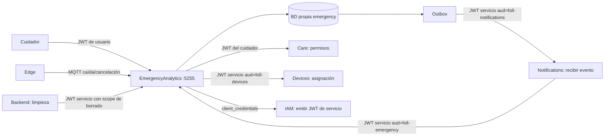

# Foll — EmergencyAnalytics v2

## Estado y alcance

Microservicio .NET 10 extraído de `../foll-backend` v2. Mantiene detección/cancelación de caídas por MQTT, incidente activo, historial/mensual, resolución, falso positivo, observaciones, dirección/coordenadas y outbox.

**Autenticación actual: únicamente JWT en EmergencyAnalytics.** Se eliminó el filtro de clave compartida, su configuración y su uso en clientes HTTP. Las rutas `/internal/...` conservan el nombre porque representan contratos entre servicios, no un mecanismo de autenticación distinto.

Arranque conjunto: [Docker Desktop local](../infra/local/README.md). Compose configura credenciales de desarrollo y bases nuevas; no transfiere datos existentes.

## Responsabilidades

Emergency es propietario de `emergency.fall_types`, `emergency.emergency_incidents` y `emergency.outbox_messages`. Care conserva pacientes/permisos; Devices conserva asignaciones; Notifications conserva destinatarios, push, SMS, enlaces y SignalR. El ejecutable no referencia los proyectos de otros BC.

Estructura: `EmergencyAnalytics/{Domain,Application,Infrastructure,Interfaces}`, `Shared` mínimo, migraciones, scripts y pruebas.



## JWT: usuarios y servicios

### API pública: JWT del usuario

Rutas protegidas mediante `Authorization: Bearer <JWT del cuidador>`:

| Método | Ruta | Uso |
|---|---|---|
| GET | `/api/emergency/incidents/active/patient/{patientId}` | Incidente activo |
| GET | `/api/emergency/incidents/history/patient/{patientId}` | Historial |
| GET | `/api/emergency/incidents/history/patient/{patientId}/monthly?month=11&year=2026` | Historial mensual |
| GET | `/api/emergency/incidents/{incidentId}` | Detalle |
| POST | `/api/emergency/incidents/{incidentId}/resolve` | Resolver |
| POST | `/api/emergency/incidents/{incidentId}/false-positive` | Falso positivo |
| PUT | `/api/emergency/incidents/{incidentId}/observation` | Observación final |

Las tres últimas reciben `{ "observation": "..." }`. Se mantienen los contratos v2 y los errores de negocio capturados como 400. Un JWT no autenticado devuelve 401. El servicio vuelve a consultar Care para comprobar acceso al paciente; no basta tener un token válido.

Los JWT de servicio se rechazan en el esquema de usuario: no se inventa un userId de cuidador para los workers. La consulta mensual conserva el filtrado en memoria de v2.

### API entre servicios: JWT de servicio

| Ruta | Audience requerida | Scope requerido |
|---|---|---|
| GET `/internal/emergency/incidents/by-key/{incidentKey}` | `foll-emergency` | `emergencies.location.read` |
| POST `/internal/emergency/patients-deleted` | `foll-emergency` | `emergencies.patients.delete` |

La consulta por clave devuelve información mínima del incidente para ubicación pública: identidad, paciente, dispositivo, estado, apertura, tipo de caída y coordenadas; no devuelve payload crudo de sensores. El borrado recibe `{ "patientIds": [25] }` (1 a 1000 IDs positivos), elimina incidentes/outbox relacionados en una transacción y devuelve 204 idempotente.

Se validan firma HS256, issuer `foll-iam`, audience, caducidad, `token_use=service`, `client_id` y scope. Firma/emisor/audience/caducidad incorrectos o ausencia de JWT: 401. JWT autenticado pero sin scope/identidad de servicio: 403. La validación de servicios usa el esquema `ServiceBearer`; no reutiliza sin restricciones la validación de tokens de usuarios.

### Obtener JWT para workers

IAM del monolito incorpora `POST /api/iam/service-tokens`, con cuerpo `application/x-www-form-urlencoded`:

```text
grant_type=client_credentials
client_id=emergency-analytics
client_secret=<credencial individual del cliente>
audience=foll-devices
```

Respuesta: `{ "access_token": "...", "token_type": "Bearer", "expires_in": 300 }` y encabezados de no caché. El cliente no elige sus scopes: el emisor concede únicamente los autorizados por su identidad/destinatario.

La credencial individual sirve para obtener el JWT ante IAM; **las llamadas entre BC viajan con el JWT**, no con esa credencial. No se usa el token de un cuidador para una tarea en segundo plano. El cliente guarda tokens en memoria por audience, renueva antes de expirar y conserva la espera/reintento de la outbox si IAM está caído. No existe fallback al mecanismo anterior.

| Cliente registrado | Audience | Scopes concedidos |
|---|---|---|
| `emergency-analytics` | `foll-devices` | `devices.assignment.read` |
| `emergency-analytics` | `foll-notifications` | `notifications.emergency.publish` |
| `notification-communication` | `foll-emergency` | `emergencies.location.read` |
| `foll-backend` | `foll-emergency` | `emergencies.location.read emergencies.patients.delete` |
| `foll-backend` | `foll-devices` | `devices.assignment.read` |
| `foll-backend` | `foll-notifications` | `notifications.emergency.publish` |

Los JWT de servicio no contienen `userId`. Notifications no recibe permiso para borrar pacientes; Emergency no puede pedir ese permiso. Clientes desconocidos, credenciales vacías/incorrectas o sin configurar se rechazan. Los tokens duran cinco minutos; se solicitan nuevos tokens mediante las credenciales del cliente, sin refresh token.

## Comunicaciones salientes

| Destino | Ruta | Autenticación actual |
|---|---|---|
| Care | GET `/internal/patients/{id}/emergency-access` | JWT de usuario reenviado |
| Devices | GET `/internal/devices/{id}/assignment` | JWT de servicio, aud `foll-devices` |
| Notifications | POST `/internal/notifications/emergency-events` | JWT de servicio, aud `foll-notifications` |

Care devuelve patientId, officialGuardianUserId, currentGuardianUserId y caregiverUserIds. Emergency compara al actor con esa información incluso si Care v1 devuelve un DTO sin comprobar pertenencia. Care v1 en :5245 solo es una fuente válida si sus IDs/datos son coherentes con Devices y Notifications.

Devices devuelve deviceId y assignedPatientId nullable. Se adaptaron tanto el endpoint del servicio Devices como su puente del monolito para aceptar JWT con el scope correcto. Notifications también se adaptó para que el receptor de **emergencias** requiera ese JWT. Las otras rutas de esos BC conservan su autenticación anterior: esta entrega no migra de forma global toda su seguridad.

El monolito y Notifications solicitan sus propios tokens para consultar Emergency. Los proxies preservan el JWT de usuario al delegar su API pública; el handler no lo reemplaza por el de un servicio.

## Eventos y MQTT

La outbox guarda el cambio del incidente y su evento en el mismo SaveChanges. El worker entrega el evento mediante HTTP y confirma su procesamiento al recibir 2xx. EventId estable: `tipo:IncidentKey`; tipos `emergency-analytics.incident-opened.v1` y `emergency-analytics.incident-closed.v1`. Payloads mantienen los records de v2 y enums como cadenas.

Notificaciones se reciben en un proceso independiente. Tras la extracción de Notifications, su confirmación 202 significa recepción durable y no envío push/SMS final. Los handlers locales de cierre MQTT se ejecutan después de esa recepción. Un fallo completo del receptor todavía retrasa ese aviso: independizar entregas por destino sigue siendo una mejora pendiente. Si el aviso MQTT de cierre falla, la outbox reintenta.

Entrada MQTT:

- `foll/devices/{id}/fall-detected`: device_id, fall_type_id o fall_type/fall_type_name, ai_confidence_score, latitude, longitude, address y timestamp.
- `foll/devices/{id}/fall-cancelled`: device_id, timestamp y reason (`USER_BUTTON_PRESSED` o desconocido).

Salida `foll/devices/{id}/incident-closed`: device_id, status, cancellation_reason, timestamp. Resolución y falso positivo manual avisan al Edge; cancelación por botón no repite el aviso.

TLS se aplica cuando se configura. La suscripción solicita QoS 1 y sesión persistente de 24h, client IDs propios y estables. Los errores transitorios evitan ACK y reconectan para reentrega. Se descartan mensajes inválidos o sin asignación. La garantía depende también del QoS del emisor y persistencia del broker; no se garantiza exactly-once. Repetir una señal antigua tras el cierre puede crear otro incidente, como en v2.

## Configuración y arranque

En IAM/monolito configurar por entorno los secretos individuales, sin almacenarlos en código:

```powershell
$env:ServiceClients__EmergencyAnalytics__Secret = 'REEMPLAZAR_POR_CREDENCIAL_INDIVIDUAL_DE_AL_MENOS_32_CARACTERES'
$env:ServiceClients__Notifications__Secret = 'OTRA_CREDENCIAL_INDIVIDUAL_DE_AL_MENOS_32_CARACTERES'
$env:ServiceClients__Backend__Secret = 'OTRA_CREDENCIAL_PARA_EL_BACKEND_DE_AL_MENOS_32_CARACTERES'
```

En la terminal/entorno de Emergency:

```powershell
$env:ConnectionStrings__DefaultConnection = 'Host=localhost;Port=5432;Database=foll_emergency;Username=foll;Password=REEMPLAZAR'
$env:JwtSettings__Secret = 'MISMA_CLAVE_DE_FIRMA_JWT_CONFIGURADA_EN_IAM'
$env:ServiceAuthentication__TokenUrl = 'http://localhost:5237/api/iam/service-tokens'
$env:ServiceAuthentication__ClientId = 'emergency-analytics'
$env:ServiceAuthentication__ClientSecret = 'MISMO_VALOR_QUE_ServiceClients__EmergencyAnalytics__Secret_EN_IAM'
$env:Services__Care__BaseUrl = 'http://localhost:5237'
$env:Services__Devices__BaseUrl = 'http://localhost:5256'
$env:Services__Notifications__BaseUrl = 'http://localhost:5257'
dotnet tool restore
dotnet ef database update
dotnet run --launch-profile http
```

Ejecutar `database update` solo después de confirmar la base destino. No se ejecuta automáticamente por defecto (`ApplyMigrationsOnStartup=false`). Puerto HTTP 5255; Swagger `/swagger` en desarrollo. `/health/live` verifica proceso; `/health/ready` verifica sus tres tablas.

Backend usa ClientId `foll-backend` y su secreto correspondiente; Notifications usa `notification-communication` y el suyo, con la misma TokenUrl. Las configuraciones `ServiceAuthentication` están en sus appsettings sin secretos reales. `ServiceJwt:Issuer` debe coincidir con el emisor; valor predeterminado `foll-iam`.

Compose ya configura las tres credenciales locales distintas, el emisor y las URLs por nombre de contenedor. Emergency no recibe la variable antigua. Para reconstruir tras este cambio desde la raíz:

```powershell
docker compose -f ./infra/local/compose.yaml up --build -d
```

Este comando es un paso del operador: no se ejecutó como parte del cambio de autenticación. En un entorno existente se deben reiniciar IAM y los consumidores adaptados, no solo Emergency. Los appsettings anteriores no contienen automáticamente estos secretos.

MQTT se configura en `EmergencyAnalyticsMqtt`: Host, Port, Username, Password, UseTls, ClientId y PublisherClientId. Para smoke/preparación sin procesamiento: `EmergencyAnalyticsMqtt:Enabled=false`, `Outbox:Enabled=false`. Los timeouts HTTP de los BC se configuran por Services; el cliente de tokens tiene timeout de 10 segundos.

## Persistencia y transición de datos

Contexto propio y migración `InitialEmergencyAnalytics`; historial en `emergency.__EFMigrationsHistory`. No se copian las migraciones completas del monolito. Se mantiene un índice único parcial de incidente abierto por dispositivo, separado del índice general.

La extracción tiene modo remoto opt-in en el monolito: `EmergencyAnalytics:RemoteEnabled=true` y `Services:EmergencyAnalytics:BaseUrl`. Desactiva sus workers de emergencias y delega REST; no elimina tablas antiguas. La limpieza por paciente se guarda en la outbox compartida junto al borrado de Care v2 y se entrega después con JWT. No se añadió limpieza por paciente a Devices ni limpieza de cuentas a Notifications.

Procedimiento de transferencia ya preparado:

1. Respaldar origen/configuración y preparar base nueva con workers detenidos. Aplicar su migración inicial.
2. Abrir mantenimiento para escrituras de emergencias y borrados de pacientes; drenar la outbox antigua cuando sea posible. Pausar Edge o asegurar buffering durante el cambio; detener ambos escritores antes del snapshot.
3. Usar servicios libpq/pgpass fuera del repositorio y ejecutar manualmente:

```powershell
./scripts/Transfer-EmergencyData.ps1 -Mode Export -PgService foll_source -BackupDirectory 'C:/backups/emergency-cutover'
./scripts/Transfer-EmergencyData.ps1 -Mode Verify -PgService foll_source -BackupDirectory 'C:/backups/emergency-cutover'
./scripts/Transfer-EmergencyData.ps1 -Mode Import -PgService foll_emergency_target -BackupDirectory 'C:/backups/emergency-cutover'
./scripts/Transfer-EmergencyData.ps1 -Mode Verify -PgService foll_emergency_target -BackupDirectory 'C:/backups/emergency-cutover'
```

4. Comparar IDs, IncidentKey, conteos/estados, ubicación, fechas, incidentes abiertos y mensajes pendientes. La importación usa columnas explícitas, checksums, transacción, secuencias reajustadas y rechaza destinos con incidentes/outbox. No copia usuarios/pacientes ni historial EF del origen. Proteger CSV como datos sensibles.
5. Reiniciar el monolito en modo remoto y el servicio con workers habilitados, con una sola réplica publicadora. Verificar JWT, consulta de permisos/asignación, detección, alertas, cierre Edge y enlace público a incidentes importados. Reanudar tráfico cuando corresponda.

Reversión antes de escrituras nuevas: detener destino y volver al origen congelado. Después de nuevas escrituras: mantenimiento, respaldos y reconciliación inversa supervisada antes de desactivar el flag; el importador no fusiona datos sobre un destino poblado. No volver simplemente a tablas antiguas ni borrar los recibos de notificación pendientes de reintentos.

## Decisiones y bitácora

### 2026-11-12 — Extracción inicial
- Se conservaron reglas y REST de v2 con namespace propio, persistencia, outbox, MQTT y adaptadores HTTP. Se agregaron pruebas, scripts SQL, Dockerfile .NET 10 y health checks.
- Se prepararon adaptadores opt-in del monolito y consulta remota para enlaces de ubicación. No se desplegó, transfirió información ni modificó tráfico real.

### 2026-11-13 — Autenticación exclusiva con JWT
- Eliminados el filtro anterior y su configuración del servicio; sustituidos por políticas JWT con audiencia/scope. API pública sigue usando identidad de cuidador y rechaza identidad de servicio.
- IAM incorpora emisión de tokens de cinco minutos mediante credenciales individuales y grants controlados por el servidor, sin tablas nuevas ni cambio al login de cuidadores.
- Workers obtienen y renuevan tokens en memoria por audience; el flujo de usuario hacia Care conserva su JWT. No hay tokens fijos hardcodeados ni fallback a credenciales anteriores en las llamadas de Emergency.
- Adaptados receptores puntuales de Devices/Notifications, puentes del monolito, clientes de ubicación/borrado y Compose. Otras comunicaciones de esos BC no se migraron globalmente.
- Los esquemas de usuario en los servicios adaptados y el monolito rechazan `token_use=service`; el JWT de un worker no habilita las APIs de cuidadores. El JWT de usuario conserva su funcionamiento, incluido SignalR.
- Se retiraron las pruebas del filtro anterior y se agregaron pruebas de emisión, rechazo de credenciales, audiencia, issuer, firma, expiración, permisos, caché/renovación y preservación del token de usuario.

## Validación y límites

Ejecutar: `dotnet test tests/Foll.EmergencyAnalytics.Tests.csproj`, `./scripts/Smoke-Test.ps1`, `dotnet ef migrations has-pending-model-changes`. La comprobación de smoke arranca el servicio real sin workers ni migraciones y con configuración sintética.

Validación final 2026-11-13:

- **35 pruebas Emergency, 30 Devices y 27 Notifications correctas: 92 en total, 0 fallidas y 0 omitidas.** Incluyen JWT real validado mediante TestHost, emisión IAM, permisos de lectura/borrado y rechazo de la clave anterior.
- Compilación correcta del monolito adaptado. Se conservan sus advertencias previas CS0168/CS0618; Notifications conserva la advertencia CS0618 de Firebase.
- Los tres scripts `Smoke-Test.ps1` pasaron con procesos reales y sin workers ni migraciones. Verificaron health, Swagger, rechazo de identidad de servicio en API de usuario y solicitudes sin autenticación. Emergency también rechazó el encabezado antiguo. Notifications completó el handshake WebSocket SignalR con JWT de usuario sintético.
- Compose válido; se comprobó que Emergency no recibe `InternalApi__ApiKey` y que cada credencial de cliente coincide con su registro en IAM. No se iniciaron contenedores.
- `git diff --check` pasó en los cuatro proyectos. La implementación de autenticación es coherente entre sus copias independientes; no se agregaron referencias de proyecto entre ejecutables.

Estos resultados cubren autenticación y regresión local. No se probó una caída completa con PostgreSQL/MQTT y proveedores reales, ni se desplegaron los servicios.

No hay transacciones distribuidas ni leasing entre réplicas. La limpieza remota es eventual y puede competir con una detección que ya obtuvo la asignación; tombstones/serialización por paciente siguen pendientes para una garantía estricta. Los reintentos requieren monitoreo de backlog y errores.

Se conserva HS256 con la clave de firma JWT compartida del sistema actual. Los grants del emisor restringen lo que entrega a cada cliente; para aislar criptográficamente a un servicio que conozca esa clave, la evolución adecuada es firma asimétrica y clave privada solo en IAM. El emisor local es un endpoint limitado de client credentials, no un servidor OAuth completo. Usar HTTPS y secretos externos fuera de desarrollo; no introducir credenciales reales en Compose.

Este cambio no requiere una migración de BD. No se aplicaron migraciones ni se alteraron datos o despliegues. Los scripts de transferencia conservan sus límites de validación: generación/revisión no equivale a haberlos ejecutado contra PostgreSQL real.
