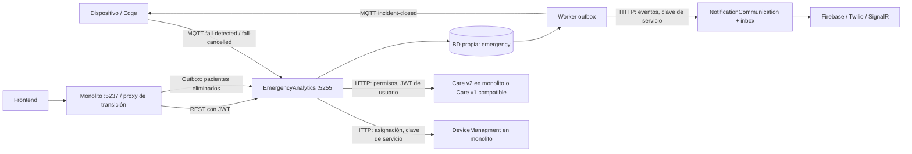

# Foll — EmergencyAnalytics v2

## Estado y alcance

Migración del bounded context EmergencyAnalytics de `../foll-backend` (v2) a un proceso independiente. `../Foll_Microservicio-Care` (v1) es la referencia de organización por capas y contratos HTTP, no la referencia de cobertura funcional.

Este documento se actualiza durante la implementación. Una sección marcada como implementada no implica despliegue ni validación contra servicios externos.

## Responsabilidad y límites

El servicio es propietario del catálogo de caídas, incidentes y outbox de emergencias. Conserva detección/cancelación MQTT, consulta activa/histórica/mensual, cierre manual, falsos positivos, observaciones, dirección y coordenadas. Care conserva pacientes/permisos; DeviceManagment conserva asignaciones; NotificationCommunication conserva push, SMS, enlaces temporales y SignalR.



Estructura: `EmergencyAnalytics/{Domain,Application,Infrastructure,Interfaces}`, `Shared` mínimo, `Migrations`, `scripts`, `tests`. Application define los puertos; Infrastructure implementa HTTP/MQTT/EF. No hay ProjectReference al monolito en el ejecutable. El proyecto de pruebas sí referencia ambos ejecutables para comprobar el adaptador de transición.

## Decisiones de arquitectura

### ADR-001 — Extracción de v2 con dominio conservado

**Contexto:** Care se extrajo en v1; el monolito tiene nuevas funciones. **Decisión:** usar .NET 10, preservar entidades/reglas/REST de v2 y sustituir únicamente las integraciones necesarias. **Alternativa:** copiar el alcance reducido de Care v1. **Consecuencia:** no perder funciones de emergencias por diferencias de versión.

### ADR-002 — Transición incremental y reversible

**Decisión:** mantener el monolito operativo por defecto y habilitar el servicio mediante una opción explícita. No ejecutar migraciones de bases existentes ni desplegar durante este trabajo. El monolito ofrecerá adaptadores de transición para sus BC aún locales.

### ADR-003 — HTTP para consultas y entrega durable de eventos

**Decisión:** gateways HTTP para asignaciones/permisos. Outbox de emergencias para entregar eventos a notificaciones por HTTP, con identificadores estables y deduplicación en el receptor. MediatR se usa solamente dentro de cada proceso. MQTT conserva el contrato con dispositivos. No se añade un nuevo broker de integración.

**Consecuencia:** consistencia eventual, reintentos y dependencia de disponibilidad de los receptores. No se promete entrega exactamente una vez de efectos externos como SMS.

## Bitácora de implementación

### 2026-11-12 — Paso 1: análisis de dependencias (completado)

- Se revisaron REST, gateways/ACL, suscriptores/publicadores MQTT, outbox, persistencia y consumidores en el monolito.
- Dependencias salientes: DeviceAssignmentAcl y PatientEmergencyAcl. Consumidores: notificaciones de apertura/cierre y consulta de ubicación pública.
- Entrada transversal: eliminación de pacientes. La eliminación individual del monolito no publicaba dicho evento; se requiere integrar la limpieza durable en la misma transacción del borrado de Care para el modo remoto.
- Riesgos encontrados: handler MQTT de cierre absorbía errores; suscriptor no aplicaba UseTls; el índice parcial de incidente abierto reutilizaba la misma definición del índice de dispositivo. Se revisarán al extraer.
- Herramientas: SDK .NET 10 disponible; `dotnet ef` no está en PATH. Se preparará herramienta local para generar migraciones sin conectar a una base.

### 2026-11-12 — Paso 2: servicio independiente (implementado)

- Se copiaron las capas de EmergencyAnalytics v2 y solo las primitivas necesarias de Shared; namespaces propios `foll_emergency_analytics`, .NET 10 y sin referencias a proyectos vecinos.
- Se crearon arranque, configuración sin secretos, perfil HTTP 5255, Dockerfile SDK/runtime 10 y contexto limitado a tres tablas del esquema emergency.
- Se reemplazaron ACL locales por gateways HTTP. Care recibe el JWT de la petición; EmergencyAnalytics verifica el DTO y la pertenencia del actor. Dispositivos y notificaciones usan `X-Foll-Service-Key` para admitir llamadas desde workers sin usuario.
- Se expusieron consulta interna por IncidentKey y borrado idempotente de incidentes/outbox por pacientes. MQTT mantiene sus topics y payloads; TLS ahora se aplica cuando se configura.
- La outbox entrega eventos HTTP con ID estable `tipo:IncidentKey` antes de los handlers locales. Si falla el aviso MQTT de cierre, el mensaje queda pendiente y se reintenta.
- Se separó el índice parcial único de incidente abierto del índice general por dispositivo.
- Migraciones al arranque desactivadas por defecto. Health live no toca dependencias; ready comprueba tablas, no la disponibilidad de todo el ecosistema.

### 2026-11-12 — Paso 3: adaptadores de transición en el monolito (implementado)

- `Shared/Infrastructure/Integration`: gateway al nuevo servicio, proxy REST, endpoints de asignación/permisos y receptor de eventos. El modo remoto es opt-in (`EmergencyAnalytics:RemoteEnabled`); no se editan secretos ni se activa en los appsettings existentes.
- En modo remoto se detienen el suscriptor MQTT y el publicador outbox de emergencias del monolito; las rutas REST existentes se delegan al nuevo servicio, conservando método, query, JWT, cuerpo y estado HTTP. Una caída del servicio devuelve 502/504.
- La ubicación pública conserva su token/expiración en notificaciones, pero consulta el incidente remoto por IncidentKey. No consulta tablas de emergencia antiguas en modo remoto.
- El receptor invoca únicamente los handlers de notificaciones; no repite el envío MQTT de cierre. Una tabla inbox de recibos y un advisory lock PostgreSQL serializan reintentos por EventId.
- La eliminación individual de pacientes y la eliminación por cuenta en modo remoto guardan el mensaje de limpieza en la outbox compartida **antes del mismo SaveChanges que elimina al paciente**. El publicador existente reintenta la entrega; el handler local de borrado de emergencias se omite en modo remoto.
- No se modificó Care v1: mantiene su contrato de lectura; sus funciones ausentes de borrado/eventos no se inventan. La topología de transición predeterminada usa Care v2 y dispositivos/notificaciones aún en el monolito.

### ADR-004 — Compatibilidad de transición

**Decisión:** conservar el código y las tablas de emergencia del monolito para permitir preparación y reversión controladas; el modo remoto evita su ejecución para tráfico REST/MQTT. **Consecuencia:** la extracción física del código antiguo se pospone al cierre operativo de la migración. Desactivar el flag después de recibir datos nuevos requiere sincronización inversa, no solo reiniciar.

### ADR-005 — Autenticación entre servicios

**Decisión:** JWT de usuario para permisos Care, clave de servicio para procesos en segundo plano y endpoints internos. Configuración vacía rechaza llamadas. Secretos solo por entorno/configuración externa. **Consecuencia:** HTTPS/red privada y rotación de claves son responsabilidades del despliegue; el prefijo internal no es una frontera de seguridad.

### ADR-006 — Idempotencia y efectos externos

**Decisión:** ID estable por apertura/cierre, recibo persistido junto con cambios de notificación y reintentos desde outbox. **Límite:** Firebase/Twilio/SignalR son externos a PostgreSQL; un fallo tras enviar y antes de confirmar puede repetir un efecto. MQTT cierre también admite duplicados. No se promete exactly-once. La outbox conserva reintentos ilimitados con error/contador; requiere monitoreo operacional y una sola réplica publicadora inicialmente.

### 2026-11-12 — Paso 4: persistencia, pruebas y transferencia (implementado)

- EF generó `InitialEmergencyAnalytics`, su snapshot y `scripts/schema.sql` sin conectar a PostgreSQL. El historial del servicio se ubica en `emergency.__EFMigrationsHistory`; no se reutiliza el historial del monolito.
- EF generó `AddEmergencyIntegrationReceipts` en el monolito: únicamente agrega `shared.integration_receipts` y su snapshot. No borra tablas de emergencia.
- Se agregaron pruebas de reglas, coordinación de incidentes/outbox, gateways, modelo EF, autenticación interna y proxy HTTP con TestHost.
- Se creó `Smoke-Test.ps1`: inicia un proceso real con credenciales sintéticas, sin workers ni migraciones, comprueba health/auth/Swagger y cierra solo ese proceso.
- Se prepararon exportación/importación/verificación con psql y manifiesto SHA-256. CSV usa columnas explícitas para tolerar el orden físico diferente de las migraciones v2. Importación rechaza un destino con incidentes/outbox y carga todo en una transacción.
- Se fijó EF Relational 10.0.7 para evitar que consumidores/pruebas resolvieran una versión transitiva distinta.

### 2026-11-12 — Paso 5: revisión de resiliencia MQTT (implementado)

- La suscripción solicita QoS 1 y sesión persistente con client ID propio y expiración de 24 horas. Ante errores transitorios HTTP/BD se evita ACK y se solicita reconexión para reentrega. Mensajes malformados o sin asignación se registran y descartan.
- La garantía efectiva requiere que Edge publique con QoS 1 o superior y que el broker persista sesiones; no se puede convertir un mensaje publicado con QoS 0 en entrega durable desde el suscriptor.
- Se conserva el comportamiento v2 de actualizar un incidente abierto en vez de abrir uno por cada detección. No se añade un identificador de señal al contrato Edge, de modo que una señal antigua repetida después del cierre aún puede abrir otro incidente; requiere evolución futura de ese contrato.

## Validación

Resultados locales registrados durante la implementación:

| Comprobación | Resultado |
|---|---|
| Compilación del microservicio | Correcta |
| Compilación del monolito con adaptadores | Correcta; advertencias preexistentes CS0168 y CS0618 |
| Pruebas xUnit/TestHost | 26 correctas, 0 fallidas, 0 omitidas en la ejecución final tras la revisión MQTT |
| Arranque real `scripts/Smoke-Test.ps1` | Correcto: live, 401 JWT, 401 clave interna y contrato Swagger |
| Generación de migraciones y SQL | Correcta, sin aplicar a bases; EF confirma que los modelos del servicio y del monolito coinciden con sus migraciones |
| Docker/PostgreSQL/MQTT reales | No ejecutados: Docker Desktop no tiene su motor activo; psql no está instalado y no hay PostgreSQL local identificado |

Las pruebas no certifican el bloqueo PostgreSQL/inbox, la transacción de importación, las sesiones MQTT ni el envío real Firebase/Twilio. Esas verificaciones requieren el entorno de integración. No se conectó a las bases configuradas en el monolito ni se ejecutó su aplicación real (aplica migraciones por defecto).

### 2026-11-12 — Paso 6: cierre de revisión local (completado)

- Se repitieron las 26 pruebas tras los cambios finales de MQTT: todas correctas. Se regeneró el SQL y se verificó ausencia de cambios pendientes del modelo del servicio.
- Se repitió el arranque real aislado: correcto. No quedaron servidores de smoke test ejecutándose.
- `git diff --check` del monolito pasó; Care v1 no tiene cambios. La búsqueda de referencias a namespaces de otros BC en el ejecutable extraído no encontró dependencias de código.
- La entrega permanece desactivada en el monolito hasta configurar el modo remoto. No se aplicaron migraciones, transfirieron datos ni cambió el tráfico real.

Para repetir:

```powershell
dotnet restore
dotnet build Foll-EmergencyAnalytics.csproj
dotnet test tests/Foll.EmergencyAnalytics.Tests.csproj
./scripts/Smoke-Test.ps1
dotnet tool restore
dotnet ef migrations has-pending-model-changes
```

La restauración inicial encontró restricciones de red/sandbox. Se restauró con autorización fuera del sandbox y se verificó la compilación. La carpeta `.tools` es un artefacto local ignorado; la herramienta reproducible se declara en `.config/dotnet-tools.json`.

## Contratos de integración

### Evaluación de sincronía entre bounded contexts — propuesta, no aplicada

`async/await` no convierte una interacción HTTP request/response en integración desacoplada. Se distingue entre transporte (el emisor espera respuesta HTTP) y proceso de negocio (la petición original puede terminar antes de ejecutar una tarea en outbox).

| Comunicación actual | Tipo actual | Recomendación para Foll |
|---|---|---|
| Emergency → Devices: GET assignment | HTTP síncrono dentro del procesamiento de una detección MQTT | Como transición, conservar. Como objetivo, proyección local alimentada por eventos DeviceLinked/DeviceUnlinked para no bloquear la detección por caída de Devices. Requiere snapshot inicial, versión/orden por dispositivo y tratamiento de asignación desconocida/obsoleta. |
| Emergency → Care: GET emergency-access | HTTP síncrono antes de consultas/acciones de usuario | Mantener síncrono para verificar permisos actuales, con timeout y rechazo seguro. Una proyección de permisos exigiría un acuerdo explícito sobre cuánto puede tardar una revocación. |
| Emergency → Notifications: POST emergency-events | Proceso asíncrono vía outbox; entrega HTTP síncrona que hoy espera procesamiento del receptor | Mantener negocio asíncrono. Evolucionar a recepción durable/cola con ACK tras persistir, sin esperar Firebase/Twilio/SignalR. |
| Notifications → Emergency: GET incidents/by-key | HTTP síncrono en la consulta del enlace público | Mantener inicialmente para estado/ubicación actuales. Considerar proyección local si se exige que el enlace funcione durante una caída de Emergency. |
| Care → Emergency: POST patients-deleted | Proceso asíncrono vía outbox del monolito; entrega HTTP síncrona | Mantener asíncrono y evolucionar a evento PatientDeleted con recibo, reintentos y tombstone por paciente. No encadenar el borrado del usuario al tiempo de respuesta de todos los BC. |

**Hallazgo prioritario:** el worker actual llama primero a Notifications y después publica con MediatR el cierre MQTT. Si falla Notifications, no se avisa al Edge en ese intento; el timeout HTTP también retrasa ese aviso. La persistencia del cierre no depende de Notifications, pero su efecto en el dispositivo sí. Se recomienda separar entregas por destino con estado/reintento propios. Así una caída de notificaciones no impide resetear el estado de caída/buzzer. Esta mejora aún no está implementada.

**Latencia:** el polling outbox predeterminado añade hasta aproximadamente 5 segundos en condiciones normales antes de un intento; backlog, errores y timeouts aumentan el retraso. Asíncrono no significa lento: la entrega debe activarse pronto, con persistencia y reintentos. Foll debe definir y medir un objetivo de tiempo desde detección hasta alerta y desde cierre hasta aviso al Edge.

**Orden de evolución recomendado:** (1) independizar cierre Edge y notificaciones; (2) retirar consulta remota de asignación del camino crítico usando una proyección confiable; (3) recepción durable de eventos en notificaciones; (4) tombstones/ordenamiento de borrados. Mantener consultas de permisos y ubicación síncronas inicialmente. No es necesario añadir un broker para todas las rutas: el criterio es disponibilidad, necesidad de respuesta inmediata y consistencia requerida.

**Alcance:** el proxy público de emergencias es request/response síncrono, pero no representa una decisión de colaboración entre dominios: es infraestructura de transición. Los mensajes MQTT con Edge son asíncronos, aunque Edge no es otro BC del backend. MediatR sigue siendo comunicación interna al proceso.

### API pública — misma ruta y forma de respuesta de v2

Todas estas rutas requieren `Authorization: Bearer <JWT de IAM>`:

| Método | Ruta | Función |
|---|---|---|
| GET | `/api/emergency/incidents/active/patient/{patientId}` | Incidente abierto |
| GET | `/api/emergency/incidents/history/patient/{patientId}` | Historial |
| GET | `/api/emergency/incidents/history/patient/{patientId}/monthly?month=11&year=2026` | Historial mensual |
| GET | `/api/emergency/incidents/{incidentId}` | Detalle |
| POST | `/api/emergency/incidents/{incidentId}/resolve` | Resolver, cuerpo `{ "observation": "..." }` |
| POST | `/api/emergency/incidents/{incidentId}/false-positive` | Falso positivo, mismo cuerpo |
| PUT | `/api/emergency/incidents/{incidentId}/observation` | Observación de incidente cerrado |

Se preservan los códigos de respuesta v2, incluido 400 para errores de negocio/permisos capturados por el controlador. El filtro JWT devuelve 401. La consulta mensual conserva el filtrado en memoria de v2; optimizarlo no fue parte de la extracción.

### Consultas salientes

| Destino | Ruta | Autenticación | Respuesta relevante |
|---|---|---|---|
| Care | `GET /internal/patients/{id}/emergency-access` | JWT reenviado | `patientId`, `officialGuardianUserId`, `currentGuardianUserId`, `caregiverUserIds` |
| Devices | `GET /internal/devices/{id}/assignment` | `X-Foll-Service-Key` | `deviceId`, `assignedPatientId` nullable |

Care v1 ya tiene el contrato emergency-access; EmergencyAnalytics verifica la pertenencia del actor aunque ese proveedor no la compruebe. Configurar Care v1 en :5245 solo es coherente si sus pacientes/IDs son la fuente de verdad que usan también dispositivos y notificaciones. Cambiar solamente la URL no migra los datos de los demás BC.

### Eventos salientes a NotificationCommunication

`POST /internal/notifications/emergency-events`, clave de servicio:

```json
{
  "eventId": "emergency-analytics.incident-opened.v1:11111111-1111-1111-1111-111111111111",
  "type": "emergency-analytics.incident-opened.v1",
  "payload": {
    "IncidentKey": "11111111-1111-1111-1111-111111111111",
    "DeviceId": 1001, "PatientId": 25, "FallTypeId": 1,
    "FallTypeName": "FRONTAL", "FallTypeDescription": "Caída frontal", "SeverityLevel": 1,
    "OpenedAtUtc": "2026-11-12T15:00:00Z", "AiConfidenceScore": 0.95,
    "Latitude": -12.05, "Longitude": -77.04, "Address": "Lima"
  }
}
```

El cierre usa `emergency-analytics.incident-closed.v1` y el record `EmergencyIncidentClosedIntegrationEvent`: mismo contexto del incidente, más `Status`, `ClosedAtUtc`, `CancellationReason`, `ClosedByUserId`, `Observation`. Los enums en estos eventos se serializan como cadenas. EventId se deriva del tipo y IncidentKey para permanecer estable al reintentar o trasladar outbox. Un 2xx confirma recepción, incluido duplicado; otro estado mantiene el mensaje pendiente. El receptor rechaza eventos mientras el monolito no esté en modo remoto.

### API interna entrante

Clave de servicio obligatoria:

- `GET /internal/emergency/incidents/by-key/{guid}`: información mínima para resolver el enlace público de ubicación, sin payload de sensores.
- `POST /internal/emergency/patients-deleted`: `{ "patientIds": [25] }`, entre 1 y 1000 IDs positivos. Elimina incidentes y outbox asociados dentro de una transacción; repetir devuelve 204.

### MQTT

Entrada `foll/devices/{id}/fall-detected`:

```json
{ "device_id": 1001, "fall_type": "FRONTAL", "ai_confidence_score": 0.95, "latitude": -12.05, "longitude": -77.04, "address": "Lima", "timestamp": "2026-11-12T15:00:00Z" }
```

También acepta `fall_type_id` o `fall_type_name`. Cancelación en `foll/devices/{id}/fall-cancelled`: `device_id`, `timestamp`, `reason` (`USER_BUTTON_PRESSED` o desconocido). Salida `foll/devices/{id}/incident-closed`: `device_id`, `status`, `cancellation_reason`, `timestamp`. El cierre manual resuelto/falso positivo avisa al Edge; una cancelación por botón no repite ese aviso.

## Transición y operación

### Configuración local

Requisitos: SDK .NET 10, PostgreSQL independiente, broker MQTT y monolito adaptado. `psql` solo es necesario para transferencia/verificación SQL. Los secretos no se incluyen en el repositorio.

En una terminal destinada al servicio, configurar valores propios:

```powershell
$env:ConnectionStrings__DefaultConnection = 'Host=localhost;Port=5432;Database=foll_emergency;Username=foll;Password=REEMPLAZAR'
$env:JwtSettings__Secret = 'REEMPLAZAR_POR_LA_CLAVE_DE_IAM_DE_AL_MENOS_32_BYTES'
$env:InternalApi__ApiKey = 'REEMPLAZAR_POR_UNA_CLAVE_INTERNA_ALEATORIA_DE_AL_MENOS_32_CARACTERES'
$env:Services__Care__BaseUrl = 'http://localhost:5237'
$env:Services__Devices__BaseUrl = 'http://localhost:5237'
$env:Services__Notifications__BaseUrl = 'http://localhost:5237'
dotnet tool restore
dotnet ef database update
dotnet run --launch-profile http
```

`database update` se ejecuta **solo después de verificar que la cadena apunta a la nueva base**. No se ejecutó en esta implementación. Por defecto `ApplyMigrationsOnStartup=false`. La API vive en :5255; Swagger en `/swagger` en desarrollo. `.http` contiene ejemplos. `/health/live` comprueba proceso; `/health/ready` verifica las tablas de su BD.

MQTT se configura con `EmergencyAnalyticsMqtt__Host`, `Port`, `Username`, `Password`, `UseTls`, `ClientId` y `PublisherClientId`. Son clientes distintos de los del monolito. Los timeouts HTTP se configuran con `Services__{Care|Devices|Notifications}__TimeoutSeconds`. `Outbox__Enabled=false` y `EmergencyAnalyticsMqtt__Enabled=false` sirven para preparar la BD sin consumir eventos.

En la terminal/entorno del monolito, para la transición:

```powershell
$env:InternalApi__ApiKey = 'MISMA_CLAVE_INTERNA_QUE_EL_SERVICIO'
$env:Services__EmergencyAnalytics__BaseUrl = 'http://localhost:5255'
$env:EmergencyAnalytics__RemoteEnabled = 'true'
```

El flag no se activó en los archivos existentes. Antes de activarlo debe aplicarse `AddEmergencyIntegrationReceipts` en la BD del monolito mediante un proceso de migración controlado. Su arranque original aplica migraciones por defecto: use `ApplyMigrationsOnStartup=false` si la operación exige aplicar SQL por separado.

El JWT compartido conserva la validación de v2 (sin issuer/audience); mejorar ese contrato requiere coordinar IAM. TLS, red privada, gestión/rotación de secretos y CORS del punto de entrada se configuran en despliegue. El frontend puede mantener su URL del monolito gracias al proxy; no se añadió CORS permisivo al servicio.

### Transferencia de datos existentes y cambio de tráfico

1. Respaldar origen y configuración. Preparar nueva BD y aplicar su migración inicial; mantener workers nuevos desactivados.
2. Aplicar la migración inbox del monolito. Probar conectividad/credenciales en integración sin activar dos consumidores MQTT de emergencias.
3. Establecer una ventana de mantenimiento para escrituras de emergencias **y borrados de pacientes**. Drenar la outbox antigua cuando sea posible. Pausar Edge o asegurar buffering durable durante el cambio; detener los escritores antiguos antes de exportar.
4. Ejecutar exportación desde el origen congelado. Libpq toma credenciales desde servicios/pgpass del operador, no desde argumentos con contraseñas:

```powershell
./scripts/Transfer-EmergencyData.ps1 -Mode Export -PgService foll_source -BackupDirectory 'C:/backups/emergency-cutover'
./scripts/Transfer-EmergencyData.ps1 -Mode Verify -PgService foll_source -BackupDirectory 'C:/backups/emergency-cutover'
./scripts/Transfer-EmergencyData.ps1 -Mode Import -PgService foll_emergency_target -BackupDirectory 'C:/backups/emergency-cutover'
./scripts/Transfer-EmergencyData.ps1 -Mode Verify -PgService foll_emergency_target -BackupDirectory 'C:/backups/emergency-cutover'
```

5. Comparar conteos, estados, IncidentKeys, incidentes abiertos, fechas, coordenadas y outbox pendiente; no solo cantidad de filas. Guardar evidencias de ambas verificaciones. Los scripts conservan PK, IncidentKey, referencias, timestamps, payloads y estados de procesamiento, y reajustan secuencias. No copian usuarios/pacientes ni el historial EF del origen. Proteger los CSV como datos sensibles.
6. Reiniciar monolito con modo remoto y servicio con workers habilitados. Mantener **una sola réplica publicadora**. Verificar que solo el nuevo servicio consume detecciones; reanudar Edge y tráfico cuando esté confirmado.
7. Verificar en integración: detección → incidente/outbox → push/SMS/SignalR; resolución/falso positivo → MQTT; enlace temporal antiguo → incidente importado; permisos de otro usuario; apagado temporal de receptor → reintento; borrado de paciente → eliminación remota.
8. Observar backlog, RetryCount/Error, latencia HTTP y logs. Archivar el respaldo. Retirar código/tablas antiguas solo después del periodo de estabilización, mediante otro cambio revisable.

Si una instancia del destino ya contiene datos, el importador se detiene; no los trunca ni sobrescribe. Los scripts son herramientas preparadas, **no ejecutadas ni certificadas contra PostgreSQL en este entorno**.

### Reversión

Antes de nuevas escrituras remotas: detener el servicio, volver a modo local y reanudar el origen congelado. Después de nuevas escrituras: volver a mantenimiento, detener ambos escritores, respaldar ambos lados y reconciliar/exportar los datos remotos hacia un origen preparado. El importador protege destinos no vacíos y no automatiza una fusión inversa. No desactivar solamente el flag: devolvería consultas a datos antiguos. No revertir/eliminar la inbox mientras haya reintentos pendientes.

### Límites operativos pendientes de validar

- No hay transacciones distribuidas. Borrado de Care y mensaje saliente son atómicos en el monolito; limpieza remota es eventual. La asignación rechaza pacientes ya eliminados. Una detección que obtuvo la asignación antes del borrado puede competir con la limpieza: para una garantía estricta se requieren tombstones/serialización por paciente, fuera de esta extracción.
- La outbox no implementa leasing entre réplicas ni dead-letter queue. Los reintentos son periódicos; eventos problemáticos deben monitorearse y resolverse. La inbox deduplica entregas completas, no efectos externos parcialmente ejecutados.
- Señales Edge fuera de orden, concurrencia de detecciones del mismo dispositivo y reenvío de señales antiguas conservan las restricciones del modelo v2. El índice único protege la BD; hace falta prueba de carga con MQTT/PostgreSQL para verificar reentregas.
- Si se usa Care v1, aún no ofrece eventos de borrado ni toda la información de destinatarios de v2; la integración completa de ese BC es una migración distinta.
- No se desplegó, publicó ni cambió tráfico real. Esta entrega prepara el código y el procedimiento para esa etapa.
